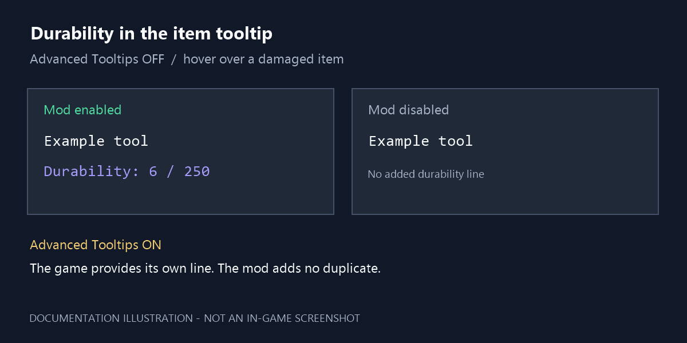

# portage-simple-durability-tooltip

Shows the remaining durability of a **damaged item** in its inventory tooltip, even with Advanced Tooltips disabled. An unofficial community Rust port of **Simple Durability Tooltip**, originally created by **Infinidoge** under the MIT license.



*Illustration of the behavior, not an in-game screenshot. Item names and numbers are examples; the real line uses the game's current language.*

## Install and use

1. Install `portage-simple-durability-tooltip-0.1.1.hnmod` through your Horizon native-mod integration. A configured Prism integration normally reads `minecraft/horizon-native-mods` inside the instance.
2. Let the integration rebuild Horizon with the mod, then launch that build.
3. Open **Options → Mods** and enable **portage-simple-durability-tooltip** if necessary.
4. Open your inventory and hover over a damaged tool, weapon or armor piece. Its tooltip shows remaining durability and maximum durability, for example **Durability: 6 / 250** in English.

No additional keybind, Fabric API, Java mod loader or configuration screen is required. This is a client-side native mod; the server does not need it. Adding, removing or changing a native package requires rebuilding Horizon through the integration. A `.hnmod` is a source-and-manifest native build package, not a Fabric JAR or a DLL.

**Upgrading from 0.1.0:** remove `simple_durability_tooltip-0.1.0.hnmod` before installing this release and rebuilding. The native ID is now `portage_simple_durability_tooltip`; do not enable both IDs together.

## Behavior

- Adds a translated durability line only for damaged, damageable items while Advanced Tooltips is off.
- Leaves the game's own durability display in charge while Advanced Tooltips is on, avoiding duplicate lines.
- Respects hidden damage tooltips, unbreakable items, empty stacks and removed damage/max-damage components.
- Reads maximum durability from an item's component override when present, otherwise from Horizon's item registry. Item durability values are not hardcoded.
- Keeps other tooltip lines and avoids adding an identical durability line twice.
- Reads item data only when the tooltip hook runs; no timer, background thread, file scan or network requests are added.

Undamaged items do not receive a line, matching the original mod. Disabling this mod does not remove the normal game's Advanced Tooltips line. The mod does not repair items or change their durability.

## Compatibility and validation

| Component | Target |
| --- | --- |
| Port version | `0.1.1` |
| Native ID | `portage_simple_durability_tooltip` |
| Minecraft | `26.3` |
| Horizon | `fdc87aecdbd116bf1e08adcd062fcbaea8c2e2ca` |
| horizon-mixins | `e59da9094f0c2fdda6c627fe9eff22dec6a906f0` |
| License | MIT |

Compatibility is pinned to these source revisions. The latest Nightly has not been checked. See [VALIDATION.json](VALIDATION.json) for the checks actually run; package validation and isolated tests do not substitute for a whole-game build or an in-game test of this release.

## Documentation

- [Usage and troubleshooting](docs/USAGE.md)
- [Original-author credits and source provenance](docs/CREDITS.md)
- [Registry form fields](REGISTRY.md)
- [Changelog](CHANGELOG.md)
- [Contributing](CONTRIBUTING.md), [security policy](SECURITY.md) and [repository rules](docs/REPOSITORY_RULES.md)
- [Release and signing instructions](docs/RELEASING.md)

## Development

Python 3.11+ and stable Rust are sufficient for the lightweight development checks:

```sh
cargo fmt --check
cargo test --locked
python scripts/check_project.py
python scripts/package.py
```

The isolated test harness invokes the actual tooltip helper against small API doubles. It tests the display behavior without compiling Horizon and does not establish compatibility with the real game API. The runtime mod contains only the list-registration helper and the tooltip helper under `mixins/portage_simple_durability_tooltip`; development tests and tools are not included in the native package.

Use the official Horizon tool to validate the package, then apply the mixins and build the game against the pinned source for integration testing:

```sh
cargo horizon-mod check dist/portage-simple-durability-tooltip-0.1.1.hnmod
```

## Credits and release authenticity

Original mod and display behavior: **Infinidoge**, [original project](https://github.com/Infinidoge/simple-durability-tooltip), [original mod page and logo](https://modrinth.com/mod/simple-durability-tooltip). Original MIT notice: [LICENSE](LICENSE). Horizon APIs: **Ludovic Marie and contributors**, [LICENSE-Horizon](LICENSE-Horizon).

Port maintainer: **fanthomas-creator**, prepared with Codex assistance. Exact source references are in [SOURCES.json](SOURCES.json) and [NOTICE.md](NOTICE.md). The included abstract bar icon is a new project illustration, not the original mod's logo.

The public minisign key is in `signing/portage-simple-durability-tooltip.pub`. The matching `.minisig` is delivered beside the package. Verify before installing:

```sh
minisign -V -p signing/portage-simple-durability-tooltip.pub -m dist/portage-simple-durability-tooltip-0.1.1.hnmod
```

Public source: https://github.com/fanthomas-creator/portage-simple-durability-tooltip. Releases include signed native packages. The mod has not been submitted to the Horizon registry.
