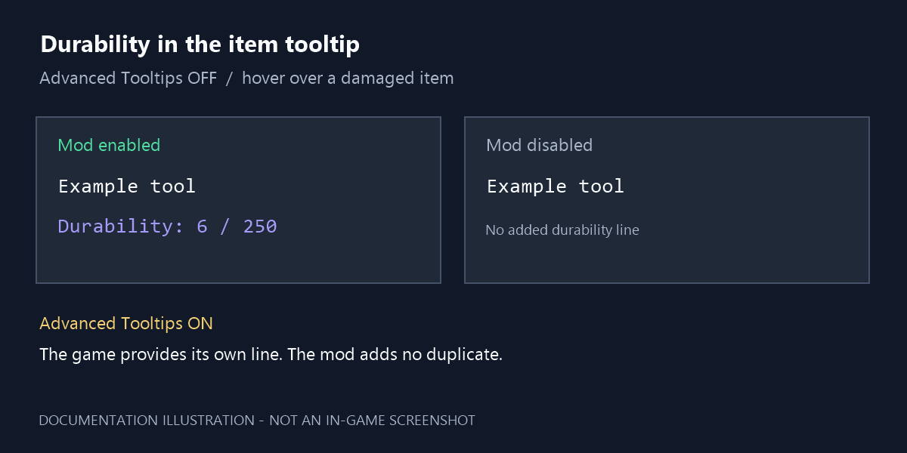

# User guide

## Requirements and installation

Use a Horizon build compatible with the revisions in compatibility.json and an integration that can build native `.hnmod` packages. No Fabric or Quilt loader is used in Horizon.

Place the package in the native-mod folder read by your integration. For the configured Prism integration, this is `minecraft/horizon-native-mods` relative to the instance. Restart through that integration so it can build the mod into Horizon. Copying a native source package alone cannot modify an already-built game.

Remove the old `simple_durability_tooltip` 0.1.0 package before upgrading. Keep only the new `portage_simple_durability_tooltip` package enabled. Your saves and game settings do not need to be changed.

## See the durability

1. Enable portage-simple-durability-tooltip in Options → Mods.
2. Open an inventory and hover over a damaged item that has durability.
3. Read the remaining / maximum durability in the tooltip.

The game translates the `item.durability` key into your selected language. For example, a damaged item with maximum 250 and damage 244 has 6 uses of durability remaining: `Durability: 6 / 250` in English. These example numbers are not a table embedded in the mod.

This is a documentation illustration, not a screenshot of Horizon. It shows the intended behavior with Advanced Tooltips off. A real gameplay screenshot of version 0.1.1 has not been captured.

## Toggle and remove

The Options → Mods switch turns the helper on or off in the built game. With Advanced Tooltips on, the game can still show its own normal durability line even when this mod is off. To remove the native code entirely, remove its package and rebuild through the integration. No separate mod configuration file or keybind is added.

## Troubleshooting

| Symptom | Check |
| --- | --- |
| No durability line | Use a damaged item; undamaged and non-damageable items are deliberately skipped. |
| Nothing changes when toggled | Disable Advanced Tooltips to compare; its vanilla line is independent of this mod. |
| Still no line | Confirm the mod is enabled and that the launched executable was built with this package. |
| A particular item has no line | Unbreakable items and items with hidden or removed damage components are skipped. |
| Native compilation fails after an update | Compare the game's source revisions with compatibility.json; latest Nightly support has not been established. Keep the last working build and report the exact error. |
| Two copies of the mod | Remove the original-ID 0.1.0 package, retain only the new package, then rebuild. |

The display uses the current client-side item data. No periodic polling or additional server messages are added. Different tooltip placement or item-component handling across Horizon Nightlies must be checked through integration testing.
